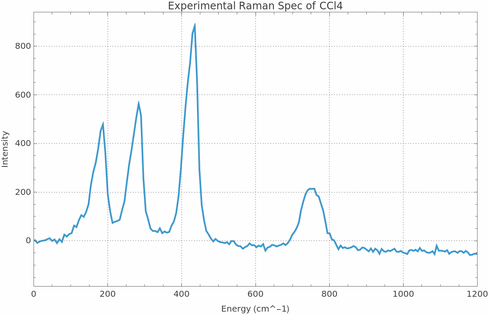
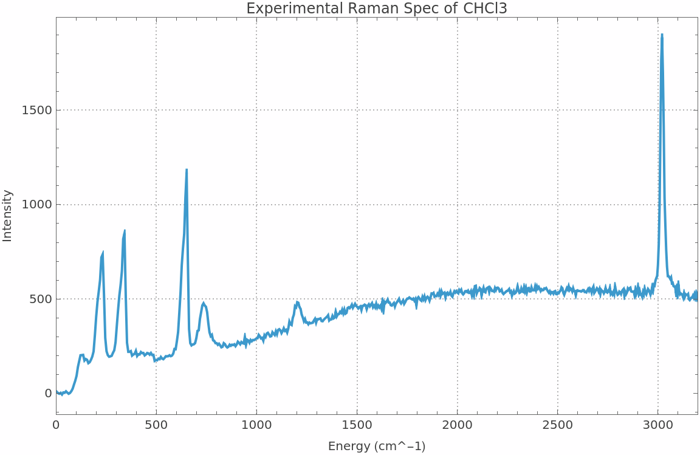
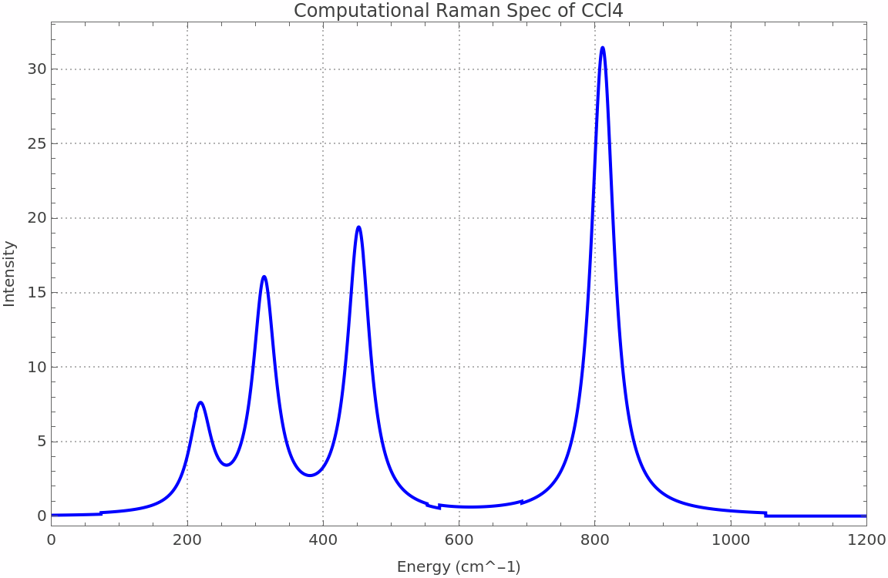
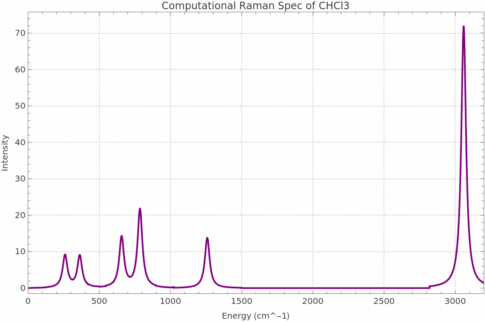
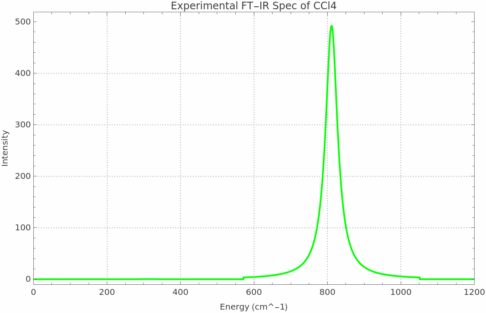
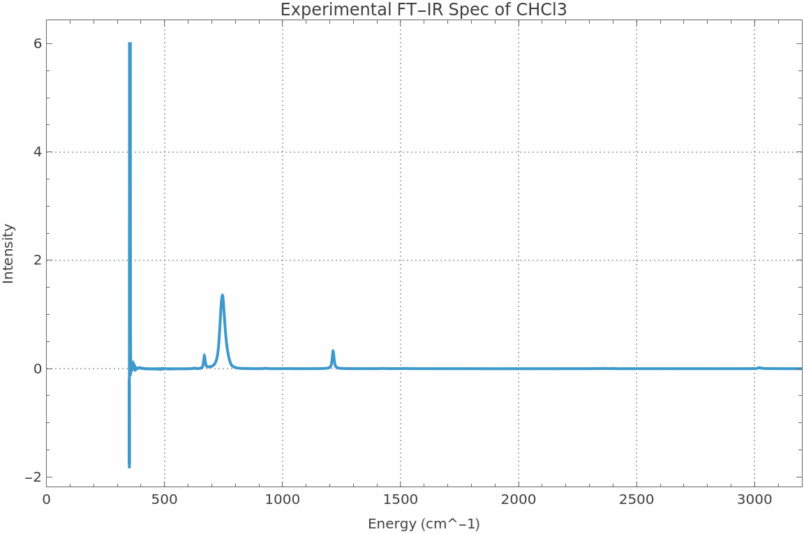
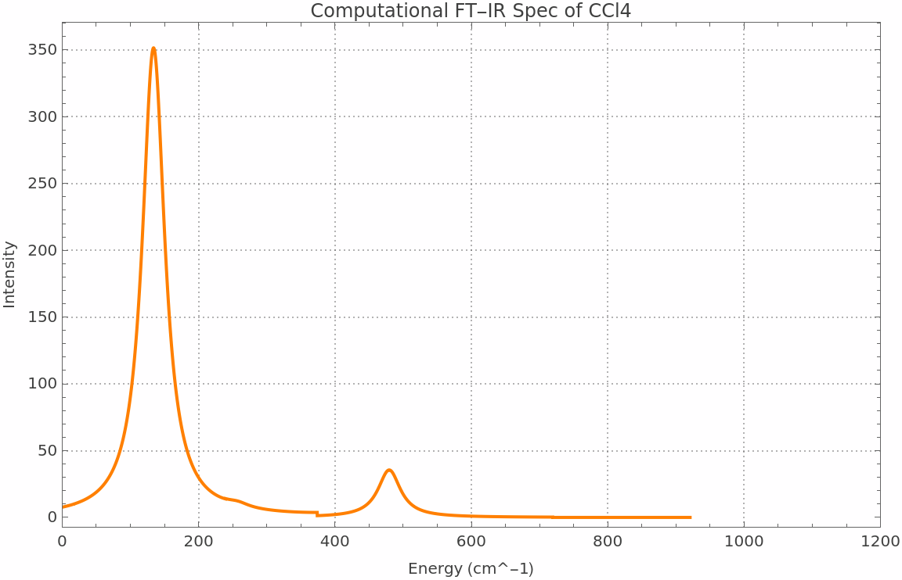
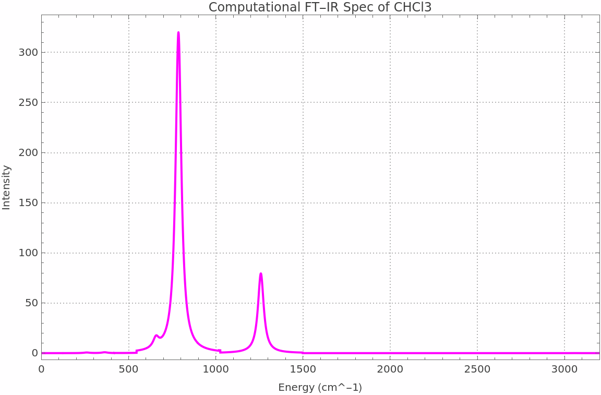

# Raman Spectra Analysis

This code takes messy instrument files and turns them into a clean list of vibration peaks, then checks those peaks against public reference values. In plain terms: Raman spectra are light-scattering measurements that show how molecules vibrate. Each vibration shows up as a peak at a particular wavenumber, measured in cm^-1. The code cleans up files in different formats, finds those peaks, and compares them with published NIST reference values for carbon tetrachloride (CCl4) and chloroform (CHCl3).

## What the code does

- `CleanData[importedData]` reads `.jdx` and `.csv` files and normalises them to a common format. Only those two formats are handled.
- `GetMajorPeaks[cleanData, sigma, relThreshold]` smooths each spectrum and picks out the major peaks above a relative threshold.
- `FindMatch[exptVal, compList]` matches each measured peak to the nearest computed peak.
- `CheckPresence[ramanVal, ftirList]` checks whether a Raman peak also appears in the FT-IR peak list. That is an overlap check only. It is not a symmetry analysis, and it does not determine whether a mode is Raman-allowed.

The notebook also runs an FT-IR cross-check on the same molecules and produces 8 plots comparing measured, computed, and FT-IR spectra.

## What the numbers say

- Measured peaks sit 20–30 cm^-1 below the NIST values across the board, about 3–4% at these wavenumbers. That is consistent with a systematic calibration offset, not an error in any single peak.
- The v1+v4 combination band appears at 773 cm^-1, overlapping the v3 band in the 760–790 cm^-1 region.
- The simple valence force-field model fails quantitatively. It uses a stretching force constant of about 434,000 dyne/cm and a bending force constant of about 33,000 dyne/cm, and it predicts v4 at 262.1 cm^-1 vs 314 observed (17% low) and v3 at 1113.6 cm^-1 vs ~773 observed (44% high). It cannot describe the asymmetric stretch. Those numbers are reported as a failed model, not as a success.

## How to run it

Open `raman-spectra-analysis.nb` in Mathematica and run it top to bottom. It loads the spectra from the `data/` folder in this repo, so no internet connection is needed. In Wolfram Cloud, run `SetDirectory[NotebookDirectory[]]` first, since the cloud kernel starts in the parent folder rather than the notebook's folder.

Expected output: cleaned spectra for CCl4 and CHCl3, peak tables with NIST comparisons, the FT-IR cross-check table, the force-field model values above, and 8 plots.

## Plots

Experimental and computed spectra, and the FT-IR cross-check, for both molecules. All eight plots are produced by running the notebook.

## Files

- `raman-spectra-analysis.nb` — the analysis notebook
- `README.md` — this file
- `data/` — the spectra the notebook loads:
  - `CCL4-IR.jdx`, `spectrum.jdx`, `spectrum-2.jdx`, `spectrum-3.jdx`, `spectrum-4.jdx` — computed and FT-IR spectra (JCAMP-DX)
  - `CCl4-Raman.csv`, `CHCl3-Raman.csv` — experimental Raman spectra
  - `CHCl3-FTIR.jdx` — FT-IR spectrum for CHCl3
- `plots/` — the eight plots the notebook produces, as PNG files

Code in this repo is under the MIT licence.
